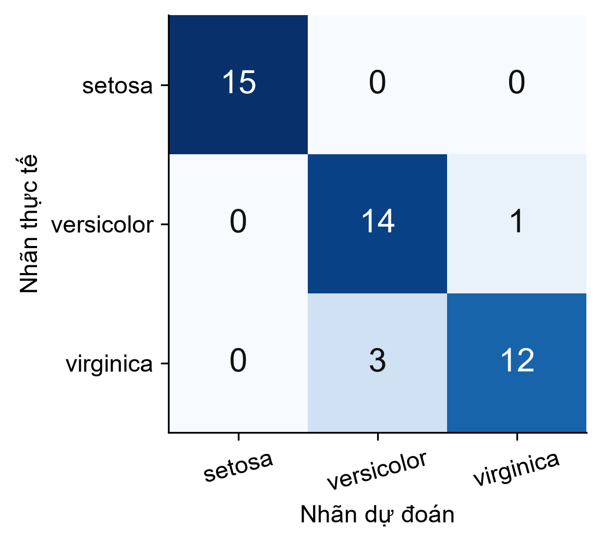

# Phân loại hoa Iris
Lê Văn Triệu - M2526034
Học phần CT999 - Công nghệ số nâng cao
Trường Đại học Cần Thơ

## Dữ liệu sử dụng
- CSV chuyển từ iris.data của UCI, có 150 mẫu và bốn số đo bằng cm.
- Ba loài hoa: setosa, versicolor và virginica.
- Không có ô thiếu. Loại ba dòng trùng theo đặc trưng và nhãn, còn 147 mẫu.
<!-- source: https://archive.ics.uci.edu/dataset/53/iris ; DOI 10.24432/C56C76 ; results/summary.json -->

## Cách chia và đánh giá
- Chia phân tầng thành 102 mẫu huấn luyện và 45 mẫu kiểm tra, random_state = 42.
- Tập kiểm tra có 15 mẫu mỗi loài.
- Đánh giá chéo năm fold chỉ chạy trên tập huấn luyện.
- StandardScaler nằm trong Pipeline của kNN và SVM.
<!-- source: results/train.csv ; results/test.csv ; src/phan_tich.py -->

## Bốn mô hình thử nghiệm
- kNN dùng 5 láng giềng gần nhất.
- SVM dùng kernel RBF, C = 1 và gamma = scale.
- Cây quyết định giới hạn độ sâu bằng 3.
- Random Forest dùng 200 cây, random_state = 42.
<!-- source: src/phan_tich.py ; DOI 10.1109/TIT.1967.1053964 ; DOI 10.1007/BF00994018 ; DOI 10.1023/A:1010933404324 -->

## F1 macro trên tập huấn luyện
<!-- chart-csv: ../results/metrics.csv -->
Trung bình năm fold. kNN đạt 0,9602 và SVM đạt 0,9597, chênh lệch nhỏ.
<!-- source: results/metrics.csv ; results/cv_scores.csv -->

## Kết quả trên 45 mẫu kiểm tra
<!-- table-csv: ../results/metrics.csv -->
Cây quyết định đúng 42/45 mẫu. Các mô hình còn lại đúng 41/45 mẫu.
Mỗi dự đoán đúng thêm tương ứng khoảng 2,22 điểm phần trăm Accuracy.
<!-- source: results/metrics.csv ; results/predictions.csv -->

## Các lỗi của mô hình SVM

Setosa đúng 15/15 mẫu.
Một mẫu versicolor bị nhầm thành virginica.
Ba mẫu virginica bị nhầm thành versicolor.
<!-- source: results/svm_confusion_matrix.csv ; results/predictions.csv -->

## Kết luận của lần thực hành
- Thứ tự theo F1 đánh giá chéo khác thứ tự trên tập kiểm tra.
- Dữ liệu và tập kiểm tra nhỏ, cần giới hạn cách diễn giải kết quả.
- Có thể chạy lại từ CSV, mã nguồn và các tệp kết quả đã lưu.
- Bước tiếp theo là thử các lần chia xác định trước và dữ liệu lớn hơn.
<!-- source: results/summary.json ; results/metrics.csv -->
